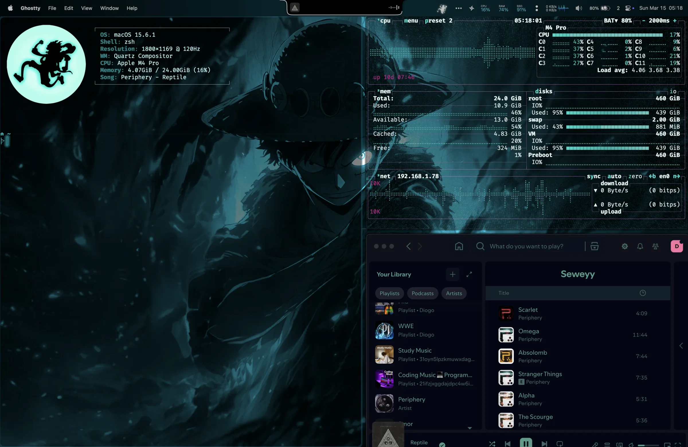

# Dotfiles



The configuration for everything on my Mac except Neovim, which is big enough to have [its own repository](https://github.com/diogof146/nvim-config). It's mostly here for other developers: when someone asks how I set something up, I can send them this. It also makes setting up a new machine easy.

Most of the history is window managers. I went from yabai with skhd to AeroSpace, then HyprSpace, and since July 2026 OmniWM. The config for each one is still here.

## What's in it

| Folder | What it is | Where it goes |
| :--- | :--- | :--- |
| `zsh` | Shell config | `~/.zshrc` |
| `starship` | Prompt | `~/.config/starship/starship.toml` |
| `ghostty` | Terminal, with a few GLSL shaders | `~/.config/ghostty` |
| `kitty` | Terminal | `~/.config/kitty` |
| `tmux` | Terminal multiplexer | `~/.tmux.conf` |
| `omniwm` | Window manager (current) | `~/.config/omniwm` |
| `hyprspace` | Window manager (before OmniWM) | `~/.config/hyprspace` |
| `aerospace` | Window manager (before HyprSpace) | `~/.config/aerospace/aerospace.toml` |
| `yabai`, `skhd` | My first window manager and its hotkeys | `~/.yabairc`, `~/.skhdrc` |
| `jankyborders` | Borders around the focused window | `~/.config/borders/bordersrc` |
| `ideavim` | Vim keys in JetBrains IDEs (a first attempt) | `~/.ideavimrc` |
| `karabiner` | Keyboard remapping | `~/.config/karabiner/karabiner.json` (a copy, not a link) |
| `spicetify` | Spotify theme | `~/.config/spicetify/Themes` |
| `discord-themes` | Discord themes for BetterDiscord | BetterDiscord's `themes` folder |
| `navi` | Cheat sheets for the terminal | navi's cheats folder |
| `neofetch` | System info on terminal start | `~/.config/neofetch` |
| `poshthemes` | Oh My Posh theme, from before Starship | `~/.poshthemes` |
| `nvimunity` | Script that makes Unity open its files in Neovim | Inside `NvimUnity.app` (setup steps are in the file) |

## How it works

Everything lives in this one folder, and almost every file is symlinked back to where its app expects to find it. So editing `~/.zshrc` edits the file in this repository, and a commit here saves the change. To use a config, link it the same way, for example:

```bash
ln -s ~/dotfiles/config/zsh/zshrc ~/.zshrc
```

Back up the file you're replacing first. Most of these configs assume macOS and the apps installed through Homebrew.

## Credits

The Ghostty shaders are from the community, and each file says who made it or what it's based on. The cheat sheets in `navi/cheats/denisidoro__cheats` are from [denisidoro/cheats](https://github.com/denisidoro/cheats); the ones in `navi/cheats/personal` are mine.

## Author

[Diogo Ferreira](https://diogof146.com)
